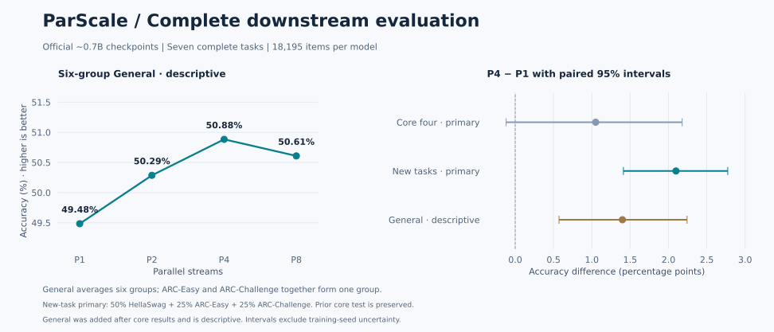

# 0.7B 下游任务复现

**七项任务、四个并行度、28 组完整评测均已完成并通过独立复核。** 最后一组于 2026 年 10 月 22 日 06:09（北京时间）结束，早于 08:00 截止时间。只使用官方约 0.7B 的 Pile checkpoint，未重新训练模型。

追加三项任务上，主要比较 **P4 − P1 为 +2.10 个百分点，95% 配对区间 [1.41, 2.77]**，满足测试前固定的判据。原四任务主要比较仍为 **+1.05 个百分点，区间 [−0.12, +2.18]**，未通过原判据；追加实验不改变这个历史结论。



## 完整准确率

每模型 **18,195 道题、66,566 个候选答案请求**；四个模型共 72,780 次逐题评估、266,264 个候选评分。全部使用完整划分，无输入截断。

| 任务或汇总 | P1 | P2 | P4 | P8 |
|:---|---:|---:|---:|---:|
| PIQA | 64.91 | 65.94 | 65.72 | 66.32 |
| SciQ | 79.80 | 81.20 | 82.70 | 80.80 |
| WinoGrande | 52.72 | 50.99 | 52.41 | 51.54 |
| OpenBookQA | 26.80 | 28.60 | 27.60 | 27.80 |
| HellaSwag | 35.66 | 36.65 | 37.72 | 38.53 |
| ARC-Easy | 49.12 | 50.76 | 52.19 | 51.47 |
| ARC-Challenge | 24.91 | 25.94 | 26.11 | 25.85 |
| 原四任务等权平均 | 56.06 | 56.68 | 57.11 | 56.62 |
| 追加任务加权平均 | 36.34 | 37.50 | 38.44 | 38.60 |
| **六任务组 General（描述性）** | **49.48** | **50.29** | **50.88** | **50.61** |

表中单位为 %。除 WinoGrande 使用 `acc` 外，其余使用按答案字符长度归一化的准确率 `acc_norm`。三个汇总回答不同问题：原四任务等权；追加任务按 HellaSwag 1/2、ARC-Easy 和 ARC-Challenge 各 1/4 加权；General 将 ARC 两项先平均，再与其余五项等权平均。

## 两轮主要检验分别解释

第一轮在预算范围内完成 PIQA、SciQ、WinoGrande、OpenBookQA。测试前固定的 P4 − P1 判据要求提升至少 1 个百分点，且配对 95% 区间下界大于零。其 +1.05 个百分点达到第一项，区间 [−0.12, +2.18] 未达到第二项，结论仍为**证据不足以满足该判据**。[第一轮冻结协议](experiments/parscale-20261021-downstream-core/protocol.md)和[原始审查](experiments/parscale-20261021-downstream-core/review.md)保持不变。

用户随后将剩余预算调整为次日 08:00 前交付。我们在查看追加任务分数前，固定 ARC-Easy、ARC-Challenge、HellaSwag 的完整划分、权重和判据，复用此前已验证的评分实现，没有重新挑选模型、种子或题目。[追加协议](experiments/parscale-20261021-downstream-rest/protocol.md)规定同样的“提升至少 1 个百分点且区间下界大于零”规则。

| 追加任务比较 | 加权差值（百分点） | 配对 95% 区间 | 定位 |
|:---|---:|:---|:---|
| P2 − P1 | +1.16 | [+0.50, +1.85] | 次要描述 |
| P4 − P1 | +2.10 | [+1.41, +2.77] | 主要比较 |
| P8 − P1 | +2.26 | [+1.63, +2.90] | 次要描述 |

**追加任务的 P4 − P1 满足两项判据。** P2、P8 及逐任务比较仅作次要描述，没有据此筛选新的主要结论。P4 在 ARC-Easy 上提高约 3.07 个百分点，在 HellaSwag 上提高约 2.06 个百分点；ARC-Challenge 的逐任务区间仍包含零。因此不能说每项任务都获得了可靠提升。

追加统计采用种子 `20261022` 的 2,000 次配对 percentile bootstrap：任务内按题目配对抽样，任务间独立抽样，再按固定权重合并。原四任务保留原种子 `20261021` 和等权分析。区间仅描述评测题目的抽样变化，不包含训练种子或 few-shot 示例选择的不确定性。

## 完整 General：描述性汇总

论文口径的六任务组平均为：

```text
General = (PIQA + SciQ + WinoGrande + OpenBookQA
           + HellaSwag + (ARC-Easy + ARC-Challenge) / 2) / 6
```

P4 − P1 为 **+1.40 个百分点，95% 配对区间 [0.57, 2.24]**。这一扩展分析在原四任务结果已知后设计，明确作为描述性结果，不能替代原四任务未通过的主要检验，也不宣称对多次检验作过统一校正。

General 点估计中 P4 高于 P8；HellaSwag 则是 P8 最高。本次证据不支持“并行流越多，所有任务就一定越好”。

## 评测设置与数据检查

| 任务 | 完整划分 | 题数 | few-shot 数 |
|:---|:---|---:|---:|
| PIQA | validation | 1,838 | 5 |
| SciQ | test | 1,000 | 3 |
| WinoGrande | validation | 1,267 | 5 |
| OpenBookQA | test | 500 | 5 |
| HellaSwag | validation | 10,042 | 10 |
| ARC-Easy | test | 2,376 | 25 |
| ARC-Challenge | test | 1,172 | 25 |

各模型使用相同题目与 few-shot 示例；模板固定于 lm-eval 0.4.8，示例种子 `20261021`，batch size 为 1，上下文上限 2,048，无额外 BOS/EOS。BF16 权重配合 FP32 log-softmax 和求和，每次完整 teacher-forced 前向重新初始化官方学习前缀缓存。

追加任务在评分前重新核对权重、Parquet、完整请求与答案索引的冻结哈希。审查又独立读取原始 Parquet 的标签字段，确认它们与冻结答案向量一致；之后从全部 217,424 个候选分数重建 54,360 条逐题结果，核对候选身份、跨模型请求一致性和所有汇总指标。见[原始标签核验](experiments/parscale-20261021-downstream-rest/raw-label-audit.json)与[独立审查](experiments/parscale-20261021-downstream-rest/review.md)。

评分前发现 ARC-Easy 有两道训练/测试题干及选项完全重合，原始行号为 242、493。主要分析保留官方完整划分，并按预先固定方案排除这两题作敏感性分析：追加加权 P4 − P1 为 **+2.0981 个百分点，95% 区间 [1.4072, 2.8001]**，结论一致。ARC-Challenge、HellaSwag 未发现题干与选项整体完全相同的训练/评测重合；仅题干重合仍存在，不能据此声称数据完全去污染。预训练语料重叠也未知。

## 与论文的对应关系

模型名“0.7B”包含嵌入参数，对应论文非嵌入参数量 **N = 0.5B** 那一列。下表的论文参考平均由[论文 v1 附录 G](https://arxiv.org/html/2505.10475v1)表 24–29 的六项已舍入分数计算；其中 ARC 为 Easy/Challenge 平均。

| 并行度 | 本次 General | 由论文六组分数计算的平均 | 本次 − 论文（百分点） |
|:---|---:|---:|---:|
| P1 | 49.48 | 49.067 | +0.42 |
| P2 | 50.29 | 49.950 | +0.34 |
| P4 | 50.88 | 50.600 | +0.28 |
| P8 | 50.61 | 50.717 | -0.11 |

[原表分数与出处](experiments/parscale-20261021-downstream-core/paper-reference.json)可供核查。评测版本与 few-shot 种子未证明和作者逐项相同，论文也未提供可配对的逐题预测，因此只作描述性对照，不对本次与论文的差异作显著性检验，不宣称逐位复现。

## 实际成本与停止状态

| 项目 | 实测 |
|:---|:---|
| 硬件 | 单张 RTX 3090，24 GB，共享环境 |
| 原四任务 16 组评分 | 2,508.1 秒，41.8 分钟 |
| 追加三任务 12 组评分 | 26,840.7 秒，7.456 小时 |
| 全七任务评分合计 | 29,348.8 秒，8.152 小时 |
| 追加阶段包装任务（含准备检查与回报） | 27,862.2 秒，7.740 小时 |
| 全下游峰值 PyTorch allocated / reserved | 3.97 / 15.92 GiB |

追加评分低于该阶段 30,600 秒上限，06:09 正常结束；执行者 06:11 前完成回报。两个服务均为 inactive、MainPID=0、控制组为空，原进程已退出，本次任务不再占用 GPU。没有启动新实验或重跑。

用户调整后的剩余时间预算取代了早期“全项目 4 GPU 小时”的上限；不能把追加完成后的项目描述为仍在原 4 小时内。上述评分计时包含模型驻留期间的 CPU 工作，不等同于纯 GPU kernel 时间；共享环境计时不能验证论文效率倍数。显存不含其他进程和全部 CUDA 上下文开销。

## 无需 GPU 即可复算

公开文件只保存逐题正确性，不包含题干、选项、原始答案标签或权重。安装 NumPy 后可复算全部统计：

```bash
python -m pip install numpy==1.26.4
python scripts/bootstrap_downstream.py \
  experiments/parscale-20261021-downstream-core/paired-outcomes.json \
  --check-against experiments/parscale-20261021-downstream-core/supervisor-independent.json

python scripts/bootstrap_downstream_extension.py \
  experiments/parscale-20261021-downstream-rest/paired-outcomes.json \
  experiments/parscale-20261021-downstream-core/paired-outcomes.json \
  --check-against experiments/parscale-20261021-downstream-rest/supervisor-independent.json
```

两条命令分别复核原四任务和追加统计，后者也覆盖排除重合题的敏感性分析及完整 General。原始候选分数保留于实验存储中；已有完整产物时可进一步执行：

```bash
python scripts/review_downstream_extension.py \
  --run-dir runs/parscale-20261021-downstream-rest-received \
  --core-outcomes experiments/parscale-20261021-downstream-core/paired-outcomes.json \
  --output runs/local-review/supervisor-independent.json
```

该入口还需要原始准备阶段的 `data-manifest.json`，其 SHA256 必须匹配冻结任务。原始文件哈希见[证据清单](experiments/parscale-20261021-downstream-rest/evidence.json)。公开仓库没有这些原始数据，只有汇总指标时不能声称完成原始逐题审查。

## 结论边界与版本

这是固定规模官方 checkpoint 的评测复现，补充了此前 WikiText-2 结果，没有复现从头预训练、跨规模 scaling law 或推理效率倍数。每个 P 只有一份权重，训练种子未知，不能把差异完全归因于并行流数量。

PIQA、SciQ、WinoGrande 来自已有缓存导出的本地 Parquet；本轮固定本地文件与行哈希，但未逐字节证明它们与登记的上游修订完全相同。追加 ARC/HellaSwag 使用已固定并核对的 Parquet。下游 FP32 仅有小样本敏感性检查，没有完整测试集 FP32 对照。此前 BF16 增量缓存一致性门槛失败仍保留，完整 teacher-forced 评分通过不代表原问题已经修复。

| 版本用途 | 提交 |
|:---|:---|
| 原四任务实际 GPU 运行 | `e2978d61162225cc5f3b82951f1852f94df2e95e` |
| 追加三任务实际 GPU 运行 | `34d4a1f9464562d563320c871e1ca1db6f2282d3` |
| 追加执行者结果 | `c84a9685858cc7529bd1c1f335e6ac4a0808ca0f` |
| 本次独立分析运行版本 | `4a0e3c1abb0ba438ccf89b7b6f8a51ad42010800` |

后续报告、图表和发布提交不是 GPU 运行版本；最终发布版本见本文件 Git 历史。完成事件 `1660a23c9f0bd4d3f89ff19afec244979b5a56f82d05c844e9dddcb0d40d4f50` 的 35 份文件（71,815,849 字节）均已验证原始大小和 SHA256，原始日志及模型数据没有上传 Git。
