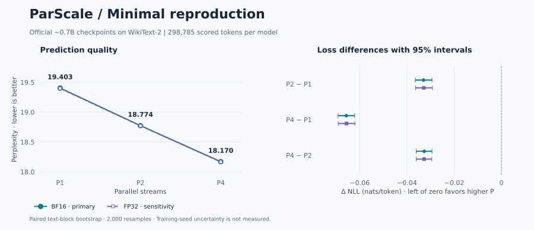
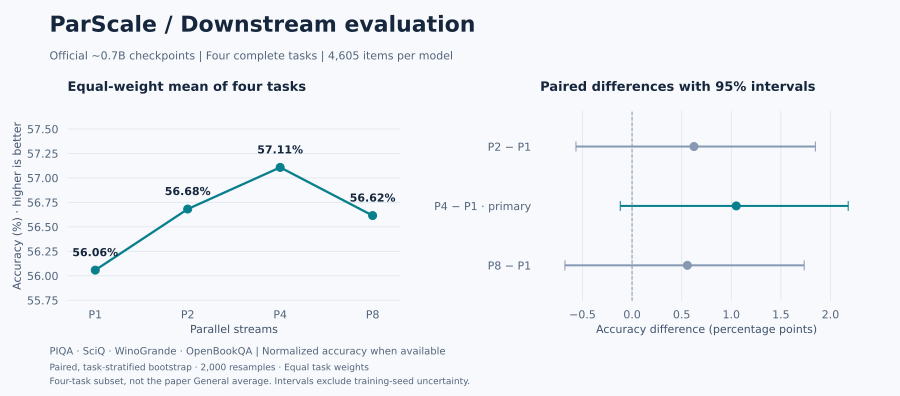

<div align="center">

# ParScale · 0.7B 复现

**模型大小几乎不变，增加并行计算，能否改善语言预测？**

Parallel Scaling Law for Language Models

**0.7B 模型 · 单张 RTX 3090 · WikiText-2 + 四项下游任务 · 独立统计复核**

[论文](https://arxiv.org/abs/2505.10475v1) · [官方实现](https://github.com/QwenLM/ParScale) · [语言建模报告](RESULTS.md) · [下游报告](DOWNSTREAM.md) · [实验协议](experiments/parscale-20261021-full/protocol-v2.md)

</div>

本仓库记录围绕 **ParScale** 的小规模实证复现：重新拟合作者公开的 scaling law 数据，评估官方约 0.7B 模型的语言预测质量，并补充 P1、P2、P4、P8 在四项下游任务上的完整评测。两轮实验于 **2026 年 10 月 21 日**完成，均经过独立统计复算。

> **目前的证据：** WikiText-2 上，P1 → P2 → P4 的预测损失持续下降，FP32 对照方向一致。四项下游任务上，P4 比 P1 平均高 **1.05 个百分点**，但 95% 配对区间 **[−0.12, +2.18]** 包含零，**未达到预设的主要成功判据**。两轮都是固定官方权重的验证，不包含完整预训练或跨规模定律验证。



<p align="center"><sub>图由已复核的指标直接生成；左图标注 BF16 困惑度，右图为配对文本块 bootstrap 的 95% 区间。</sub></p>

## ParScale 在研究什么？

通常，提升语言模型能力会让人想到增加参数或生成更长的推理过程。[ParScale 论文](https://arxiv.org/abs/2505.10475v1)研究另一种方式：让多个计算分支共享主体模型参数，对输入施加不同的可学习变换，再动态聚合分支输出。

这里的 **P 是并行流数量**，P1、P2、P4、P8 对应 1、2、4、8 条流，并不要求同样数量的 GPU。我们将官方权重依次放在同一张 RTX 3090 上评估：WikiText-2 比较 P1/P2/P4，下游评测进一步覆盖 P8。

## 我们得到了什么？

### ① 官方模型在完整测试集上的比较

**数据：** WikiText-2 test；293 个文本块，每模型、每精度共计分 **298,785 个目标 token**。上下文长度为 1,024，batch size 为 1。

| 模型 | 参数量 | BF16 损失 ↓ | BF16 困惑度 ↓ | FP32 损失 ↓ | FP32 困惑度 ↓ |
|:---|---:|---:|---:|---:|---:|
| P1 | 671.95M | 2.965453 | 19.4035 | 2.965116 | 19.3969 |
| P2 | 674.33M | 2.932469 | 18.7739 | 2.932292 | 18.7706 |
| **P4** | **676.71M** | **2.899778** | **18.1701** | **2.899535** | **18.1657** |

损失为平均负对数似然（NLL），单位 nats/token；困惑度为 `exp(NLL)`。两者都是越低越好，表中均按实际目标 token 数加权。

主要比较 **P2 − P1** 的 BF16 损失差为 **−0.032983**，95% 置信区间为 **[−0.036439, −0.029395]**。P2 的相对下降为 **1.1123%**，P4 又进一步改善，满足测试前固定的三个判据：P2 下降至少 0.5%、差值区间上界低于零、P4 不差于 P2。

FP32 下，P2 的相对下降为 **1.1070%**，同样满足判据。区间来自固定随机种子的 2,000 次配对文本块重采样；它描述测试文本的抽样变化，不代表不同训练种子之间的不确定性。

### ② 四项下游任务的完整评测

**数据：** PIQA、SciQ、WinoGrande、OpenBookQA 的完整评测划分，每模型共 **4,605 道题**。四个并行度共完成 16 组评测，没有截断输入。

| 任务 | P1 | P2 | P4 | P8 |
|:---|---:|---:|---:|---:|
| PIQA | 64.91 | 65.94 | 65.72 | 66.32 |
| SciQ | 79.80 | 81.20 | 82.70 | 80.80 |
| WinoGrande | 52.72 | 50.99 | 52.41 | 51.54 |
| OpenBookQA | 26.80 | 28.60 | 27.60 | 27.80 |
| **四任务等权平均** | **56.06** | **56.68** | **57.11** | **56.62** |

表中为准确率百分比：除 WinoGrande 外，均采用按答案字符长度归一化的准确率。few-shot 数依次为 5、3、5、5，模板和随机种子固定。



测试前固定的主要比较是 P4 − P1，要求平均提升至少 1 个百分点且 95% 区间下界大于零。实测 **+1.05 个百分点**达到了前一项，区间 **[−0.12, +2.18]** 未达到后一项，因此本轮**尚不能确认该判据下的稳健提升**。分数也没有随 P 单调增长；P8 的平均分点估计低于 P4。

本阶段评分耗时 **41.8 分钟**，峰值 PyTorch reserved 显存 **15.86 GiB**。七项任务全量预估超过既定预算，HellaSwag 和 ARC 在访问测试分数前暂缓；这里的四任务均值不是论文的六任务组 General 均值。下游 FP32 只做了小样本检查。[查看完整报告、论文对照与复算方法](DOWNSTREAM.md)。

### ③ 作者公开数据的重新拟合

我们从固定版本的官方代码读取每个语料的 **24 个公开数据点**，沿用多起点 L-BFGS-B 和对数空间 Huber 目标，重新拟合论文中的关系。

| 语料 | 数据点 | 重拟合 R² |
|:---|---:|---:|
| Pile | 24 | 0.998676 |
| Stack-v2-Python | 24 | 0.997833 |

这一步验证公开数据与拟合实现的一致性；这些数据点来自作者，不能视为我们独立训练得到的新证据。[查看拟合结果](experiments/parscale-20261021-smoke-r3/fit-results.json)。

### ④ WikiText-2 阶段的实际成本

| 项目 | 本次实测 |
|:---|:---|
| 使用硬件 | 1 × NVIDIA RTX 3090，24 GB |
| 峰值 PyTorch reserved 显存 | **4.36 GiB** |
| 峰值 PyTorch allocated 显存 | 3.82 GiB |
| 验证预检 + 六组全量评估及生成计时 | **435 秒，约 7.3 分钟** |

耗时不含模型下载、前期诊断、报告和统计复核；显存数值不含其他用户进程与全部 CUDA 上下文开销。GPU 存在共享负载，生成计时仅作为运行观察，本次没有验证论文中的效率倍数。

## 怎样理解这次复现？

三项设计让结果更容易核查：**模型与数据版本固定**，全部权重逐一校验 SHA256；**测试前确定评价规则**，正式评分前确认实现，再按冻结规则评测；**独立复算统计**，用不导入评估器的 CPU 脚本核对逐块损失、逐题准确率、配对区间和计时摘要。

有一个需要保留的数值问题：早期诊断中，BF16 的增量缓存一致性误差未通过原定阈值。我们保留了失败结果，并在完整测试前单独固定新的评价协议：使用真实前文评分，每块重新初始化官方前缀缓存，不跨块复用，再增加全量 FP32 对照。**本轮损失评估通过，不表示原缓存问题已经修复。** [查看数值诊断与处理依据](experiments/parscale-20261021-cache-diagnostic-v4/review.md)。

此外，每个 P 只有一份 checkpoint，训练种子未知，WikiText-2 与预训练语料是否重叠也未知。因此，WikiText-2 结果支持这三份模型在该语料上的改善趋势；下游任务的主要区间仍包含零。更广泛的 scaling law、训练稳定性和部署效率还需要更多实验。

## 从哪里开始？

| 你想了解什么 | 阅读入口 |
|:---|:---|
| 语言建模结果、资源成本与结论边界 | [RESULTS.md](RESULTS.md) |
| 四项下游结果、论文对照与局限 | [DOWNSTREAM.md](DOWNSTREAM.md) |
| 无需模型即可复算的下游统计 | [逐题正确性](experiments/parscale-20261021-downstream-core/paired-outcomes.json) · [独立审查](experiments/parscale-20261021-downstream-core/review.md) |
| 评价方法与测试前固定的判据 | [实验协议](experiments/parscale-20261021-full/protocol-v2.md) |
| 可用于分析的结构化指标 | [metrics.json](experiments/parscale-20261021-full/metrics.json) |
| 独立复核做了哪些检查 | [审查记录](experiments/parscale-20261021-full/review.md) · [复算结果](experiments/parscale-20261021-full/supervisor-independent.json) |
| 模型、数据及权重来源 | [版本锁定](locks.json) · [权重哈希](configs/model-sources.json) |

## 自己复算

### 只需 CPU：重新拟合公开数据

在仓库根目录执行以下命令。拟合数据随固定的上游脚本保存，无需下载模型权重。

```bash
python3 -m venv .venv
source .venv/bin/activate
python -m pip install numpy==1.26.4 scipy==1.14.1

python scripts/fit_scaling.py \
  --out runs/local-fit/fit-results.json \
  --run-id local-fit
```

输出包含两组拟合参数、R²、各点残差与优化信息。由于数值环境差异，末位数字可能略有变化。

### 只需 CPU：重算下游差值与置信区间

公开文件保存了逐题正确性标记，无需下载模型或数据集即可复算：

```bash
python scripts/bootstrap_downstream.py \
  experiments/parscale-20261021-downstream-core/paired-outcomes.json \
  --check-against experiments/parscale-20261021-downstream-core/supervisor-independent.json
```

命令会核对平均值、差值、区间和主要判据，结果应与已提交审查完全一致。

### 已有运行产物：复核完整测试统计

独立审查只需要 NumPy 和原始逐块 JSON，不需要 GPU。`runs/` 中的原始运行产物未纳入 Git；在已有完整运行目录的机器上执行：

```bash
python scripts/review_full_results.py \
  --run-dir runs/parscale-20261021-full \
  --out runs/parscale-20261021-full/local-review.json
```

输入文件为 `full-results.json`、`test-data-manifest.json` 和 `pretest-validation.json`。对应文件哈希见 [evidence.json](experiments/parscale-20261021-full/evidence.json)；只有汇总指标时，可以阅读审查结果，但不能重新执行逐块审查。

<details>
<summary><strong>进一步运行 GPU 评估</strong></summary>

实测环境为 Python 3.10.12、PyTorch 2.2.2 + CUDA 12.1、Transformers 4.51.3；完整版本见 [environment.json](experiments/parscale-20261021-full/environment.json)。

GPU 入口 [run_full_evaluation.sh](scripts/run_full_evaluation.sh) 需要现成缓存和已审查的验证集参考记录。运行前通过 `PARSCALE_RUNTIME_DIR` 指定本机缓存/依赖目录，通过 `PARSCALE_GPU_UUID` 指定获准使用的 GPU；公开文件不保存真实服务器身份。它不能在新机器上直接作为安装命令运行。

迁移到新机器时，需要按以下顺序准备：

1. 按 [locks.json](locks.json) 获取三份官方模型和 WikiText-2 的固定版本。下载优先使用 `HF_ENDPOINT=https://hf-mirror.com`，并核对 [权重哈希](configs/model-sources.json)。
2. 配置实际设备、依赖、缓存路径，以及新运行目录中的 `raw/downloads/model_paths.json`。
3. 参考 [v4 诊断入口](scripts/run_diagnostic_v4.sh)完成数值诊断，保留验证集参考结果。
4. 为新运行保存 task 与协议，提交实际代码和配置，再执行验证预检与完整测试。完整评估入口会核对验证结果和代码版本。

实现细节见 [full_evaluation.py](scripts/full_evaluation.py)。已完成的运行目录有一次性启动锁，新的实验应使用新的目录。

</details>

<details>
<summary><strong>重新生成本页图表</strong></summary>

```bash
python -m pip install -r docs/requirements-figures.txt
python docs/plot_results.py
python docs/plot_downstream.py
```

图表直接读取已提交的独立复核指标，输出语言建模与下游评测的 SVG、PNG，无需重新运行实验。

</details>

## 仓库结构

```text
├── README.md                  # 项目概览与阅读入口
├── RESULTS.md                 # 语言建模实验报告
├── DOWNSTREAM.md              # 四项下游任务报告
├── locks.json                 # 模型、数据和基础评价配置
├── configs/                   # 权重下载来源与校验值
├── docs/                      # 结果图及绘图脚本
├── scripts/                   # 拟合、诊断、评估和独立审查
├── experiments/               # 各阶段协议、脱敏指标和审查记录
│   └── parscale-20261021-full/ # 本次完整测试
└── upstream/                  # 固定版本的作者代码
```

模型权重、原始数据和运行日志留在实验存储中，仓库保存代码、配置及可核查的轻量结果。

## 来源与致谢

本项目基于 Mouxiang Chen 等人的 [*Parallel Scaling Law for Language Models*](https://arxiv.org/abs/2505.10475v1) 和 [QwenLM/ParScale](https://github.com/QwenLM/ParScale)。模型来自作者发布的 ParScale checkpoint，论文方法、公开数据及上游代码归原作者所有。

使用本仓库中的研究结果时，请区分原论文结论与本次固定官方权重的评测。固定上游版本及来源说明见 [UPSTREAM.md](UPSTREAM.md)。WikiText-2 实际全量运行标识为 `5acb76e`，下游实际运行标识为 `e2978d6`；它们与后续报告和公开整理版本区分保存。公开文件中的身份字段可能已替换，原始证据哈希的含义见 [公开审查说明](docs/publication-audit.md)。
